<div align="center">

<!-- animated contribution graph: real data, boxes reveal cell by cell
     (regenerated daily by .github/workflows/update-profile-art.yml) -->

<h3><code>adithyasgurikar@github ~ $ whoami</code></h3>

```
Name      :  Adithya Shashikumaar Gurikar
Education :  M.S. Computer Science — University of Illinois Urbana-Champaign
Focus     :  [ ]
Experience:  [ ]
Location  :  [ ]
Interests :  [ ]
Languages :  [ ]
Currently :  [ ]
Contact   :  [adithyagurikar10@gmail.com]
Fun Fact  :  [ ]
```

<table>
<tr>
<td valign="top"></td>
<td valign="top"></td>
</tr>
</table>

<h3><code>adithyasgurikar@github ~ $ ./contributions.sh</code></h3>



<br>
<br>

<!-- ascii portrait (left) + streak/numbers card (right). both svgs are
     840x880 so equal widths give equal heights.
     portrait: python scripts/prep_photo.py <dp.png> && python scripts/make_ascii_svg.py
     stats:    python scripts/render_stats_svg.py (same daily workflow) -->

<h3><code>adithyasgurikar@github ~ $ ./skills.sh</code></h3>

<p><b>Languages</b></p>


<p><b>Frameworks & Libraries</b></p>


<p><b>Tools & Cloud</b></p>


<br>
<br>

<h3><code>adithyasgurikar@github ~ $ ./links.sh</code></h3>

<!-- <p><b>AI Builder</b></p> -->

<!-- [](https://www.avivashishta.com) -->

[](https://www.linkedin.com/in/adithya-shashikumaar-gurikar/)

[](https://tinyurl.com/adithyasgurikar)

<!-- [](https://avivashishta29.github.io) -->

<br>
</div>